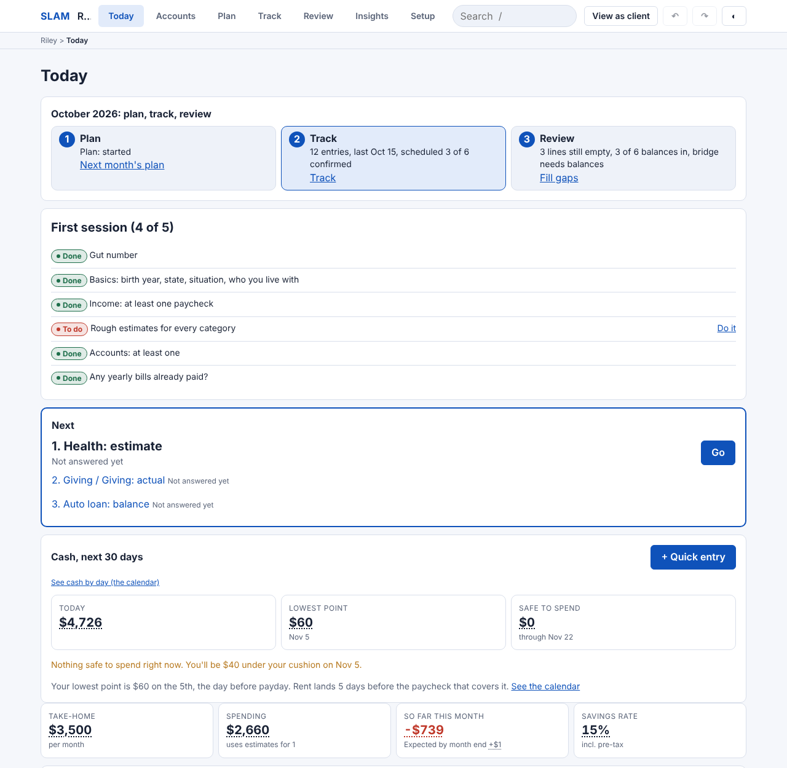

# SLAM: Stress Less About Money

SLAM is budgeting software a money coach runs live with a client, one household at a time, on a
laptop or a phone. The client guesses first, the log finds the truth, and every month closes with
a plain answer to "where did the money go, and why does the bank not match the budget?"

It is for coaches who work from a client's own numbers rather than a template, and for the clients
who sit beside them. It runs in the browser from static files: no server, no account, no build step,
and nothing leaves the device unless the coach exports a file. Every demo household is made up.



## Run it locally

```
git clone https://github.com/Sapphirestoneage/Personalfinance.git
cd Personalfinance
npm run serve          # python3 -m http.server 8765, serving slam/
```

Then open http://localhost:8765/ and click **Try with example numbers** on the Clients screen.
Any static server works; serving over HTTP matters because the app fetches its reference tables and
demo households. The live copy is at https://sapphirestoneage.github.io/Personalfinance/slam/.

## Run the tests

```
npm test               # 350 unit tests in about ten seconds (node --test, no dependencies)
npm run test:browser   # the three Playwright checks, with slam/ served on port 8765
```

Start with `slam/tests/engines-roundnumbers.test.js`: small round numbers you can check in your
head, one engine at a time. The household tests then compare whole budgets against hand-computed
answers in `slam/src/data/households/`. The browser checks load each demo household in Chromium and
compare what the screens show to the same answers, count the taps for four coaching journeys, and
fail any screen taller than six phone screens. They need Playwright:
`npm install --no-save playwright && npx playwright install chromium`.

## What is where

| Path | What it is |
| --- | --- |
| `slam/index.html` | The app. One page; the screens are hash routes (`#today`, `#plan`, `#track`, `#review`, `#insights`, `#setup`, `#clients`). |
| `slam/src/engines/` | Pure math, 43 modules. Every number on every screen is computed here, in dollars, from the household and the reference tables. Nothing in here touches the page. |
| `slam/src/store/` | The number store: the household document and its schema, validation, migrations, undo and redo, month close, export and import, record versions, who sees what. |
| `slam/src/ui/` | Screens, components and SVG charts. They read one summary object and format it. `nav.js` is the single map of where everything lives. |
| `slam/src/data/` | Reference tables (2026 tax constants, spending averages, benchmarks, merchant rules), each with its source and year, and the seven demo households with their hand-computed expected answers. |
| `slam/tests/` | Unit tests, `node --test`. |
| `slam/tools/` | The Playwright checks, the journey tap counter, the screenshot gallery, and the generators that rebuild two demo households from a fixed seed. |
| `slam/README.md`, `slam/LESSONS.md`, `slam/DECISIONS.md` | The app's own guide, the 23 rules every change is checked against, and the dated decisions log (S-001 onward). |
| `docs/` | For a newcomer: `TOUR.md` (ten minutes, start here), `ARCHITECTURE.md`, `DECISIONS.md` (the main decisions with their why), `GLOSSARY.md`, `AUDIT.md` (the state of the repository before the 2026-10-23 cleanup). |
| `KNOWN_ISSUES.md` | Bugs, rough edges and debt, ranked. |
| `archive/` | Every earlier generation of this idea, unchanged, with [the story of how one led to the next](archive/README.md). |
| `rooms/`, `dnd/`, `coach/`, `marketing/`, `money-rooms-v3/`, `map.html` | Redirect stubs. Addresses that were public before the archive move still land. |

## Where it stands

**Done.** The Budget, built around the monthly loop: Plan (next month from last month's plan or the
client's estimates, which are never overwritten), Track (one log for quick entries, scheduled bills
and paychecks, and bank CSV files matched against what was already logged), Review (fill the gaps,
close the month with a checklist, keep the review). Insights: where it goes, estimate vs actual vs
plan, trends, the cash calendar with safe to spend, the bridge from budget surplus to the change in
cash, two net worths (total and FI) with their own bridge, and the DRAFTT and 50/30/20 lenses. Setup
for income and paychecks with a tax check, health coverage, accounts, debts with computed card
interest, bills and due dates. Clients: several households per browser, export, import with merge.
Every record carries an id, timestamps, author and version, so a shared version can come later
without a rewrite.

**In progress.** Two branches add a Ledger and a Dashboard beside the Budget
(`claude/slam-phase-1-foundation`, `claude/slam-phase-2`). The cleanup pass this README comes from
is on `cleanup-for-review`; see `docs/AUDIT.md` and `KNOWN_ISSUES.md`.

**Planned.** Hosting with a coach sign-in and a client view (`slam/HOSTING.md` says what is already
in place for it); the tools that read the Budget's numbers next: FIRE, emergency fund, debt payoff;
more bank file formats; verified averages each year. The full list of parked ideas is
`slam/PARKING_LOT.md`.

## Before SLAM

This is the fifth attempt at the same idea in four months, by a coach working with Claude Code. The
earlier four (a one-page ladder calculator, SPARKS with its 93 rooms, Money Rooms v2 and v3) are in
`archive/`, and [archive/README.md](archive/README.md) says what each one taught. The 23 rules in
`slam/LESSONS.md` are the short version.

## Not financial advice

SLAM arranges a household's own numbers so a coach and a client can talk about them. It does not
give advice, and its tax figures are estimates labeled as such.
