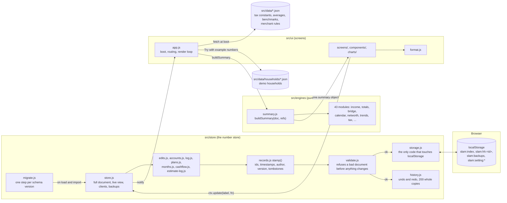

# Architecture

How SLAM is put together: where the data lives, how it moves, and what each piece is allowed to
do. Everything here was read from the code on 2026-10-23; paths are relative to `slam/`.

## The shape in one paragraph

One household is one JSON document. It lives in the browser's `localStorage` and is the only state
there is. Screens never change it directly: they ask the store to apply a named change, the store
clones the document, runs the change, validates the result, stamps every changed record with a new
version, saves, and tells the app to re-render. A render computes everything from scratch: the
engines (pure functions, no DOM) take the document and the reference tables and return one summary
object; the screens read that object and format it. Undo and redo are whole-document copies. Export
is the document in an envelope; import merges record by record.

## Data flow

Two outside paths join the same store: a bank CSV goes through `engines/tx-import.js`
(`importCSV`) and `engines/log.js` (`matchImport`) before `store/log.js` (`mergeImport`) writes it;
an exported client file goes through `store/transfer.js` (`parseImport`, which also migrates and
validates) and `store/merge.js` (`mergeDocs`, `resolveMerge`) before it lands.

## The pieces and what each may do

| Piece | Responsibility | May import from |
| --- | --- | --- |
| `src/store/` | Hold the household, change it safely, keep history, save and load, export, import and merge, decide who sees what. | `engines/` for a few pure helpers (`normalize.js`, `tx-import.js`). Never `ui/`. |
| `src/engines/` | Compute every number the screens show, from the document and the reference tables. No DOM, no storage, no side effects. | Other engines. Never `store/` or `ui/`. |
| `src/ui/` | Draw the screens, route between them, format numbers, collect input and hand it to the store as a named change. No arithmetic on money (checked by the audit, `AUDIT.md` section 7). | `store/` and `engines/`. |
| `src/data/` | Reference tables, each with its source and year, and the demo households with hand-computed expected answers. | Nothing; plain JSON. |
| `tests/` | `node --test`. Engine math and store behavior against the households and small round examples. | Everything. |
| `tools/` | Playwright checks (what the screens show versus the expected files, tap counts, layout limits, a screenshot gallery) and the two seeded generators that rebuild Riley and Dana. | Everything; needs a static server and Playwright. |

### How an edit travels

1. A screen calls `ctx.update(label, fn)` (or `ctx.commit(path, value, label)`, which is the same
   with `setField`). `setField` in `store/edits.js` refuses to type over a line whose actual comes
   from the log (S-087).
2. `store.update` clones the live document, runs `fn` on the clone, checks the estimate log was not
   edited by hand and appends a row for every changed estimate (`estimate-log.js`, S-090), sets
   `updatedAt`, then `records.stamp` gives every changed record `updatedAt`, `updatedBy` and
   `version + 1`, and turns a removed record into a tombstone (`deleted`, `deletedAt`, `deletedBy`).
3. `validate.validateHousehold` runs on the live view of the result. The first problem throws
   "Change refused: ..." and nothing changes, not the document and not the undo stack.
4. `storage.saveClient` is queued (saves are async and chained); `history.record` keeps the previous
   document; the store notifies the app, which schedules one render.
5. Undo and redo (`history.js`, Ctrl or Cmd+Z, Shift for redo) swap in a whole earlier document and
   go through the same validate-and-save path.
6. A live preview while typing (`ctx.preview`) runs `buildSummary` on a throwaway clone and never
   saves.

### How a render happens

`render()` in `app.js` saves focus and scroll, computes `summary = buildSummary(doc, refs)`, calls
the screen for the current hash route with `(ctx, summary)`, adds the top bar, crumbs, bottom bar
and quick-entry sheet, replaces the page's children, and restores focus and scroll. Repeated
notifications within a tick merge into one render. `buildSummary` (`engines/summary.js`) runs the
engines in a fixed order: income, the budget model, totals, month history, completion and the Next
items, then the lenses (50/30/20, DRAFTT, income statement, joy), card interest, tags, plan shares,
the dream life and eras, "since last time", Next stage and the transaction analysis. Screens also
call engines directly on the document for things the summary does not carry (the loop strip, the
checklist, the calendar, net worth), and the charts take their data from `engines/chart-data.js`
and one engine each.

What the coach sees versus the client: `app.js` wraps the live document with
`visibility.viewFor(doc, role)`, which blanks the coach-only fields (coach notes, plan notes, a
mistake tag until shared, the cushion, the materiality) when "View as client" is on (S-096).

### Month close

Review shows `monthEndChecklist`. Closing builds the saved review (`engines/loop.js monthReview`:
plan versus actual, the bridge, the forecast check, top merchants, the 80/20 split, the readings),
then three named changes in a row: `closeMonth` (push the snapshot into `months[]`, move
`currentMonth` forward, apply the plan's stops), save a snapshot for "since last time", and save the
cash forecast the next month will be checked against. A late entry for a closed month goes into
`months[i].revised` and never edits the snapshot.

### Export, import, merge

Export stamps `sync.versions` (the version of every record at the moment of sharing) and downloads
`{ format: 'slam-household', exportVersion: 1, exportedAt, household }`. Import parses, migrates and
validates the file, backs up every household in the browser first (the last ten backups are kept,
S-004), then either adds the client or merges: records are compared by `collection:id` against the
last shared versions, sorted into added, from incoming, from local, same, and conflicts; a conflict
is a record changed on both sides and waits for the coach to pick (S-096). Fields that are not
records (profile, settings, the open month's actuals, forecasts) keep the local copy.

### Where the document lives

| `localStorage` key | Holds |
| --- | --- |
| `slam:index` | The client list, `[{ id, name, updatedAt }]`, without deleted clients. |
| `slam:hh:<id>` | One full household document, tombstones included. |
| `slam:backups` | Up to ten backups, each a list of full documents with when and why. |
| `slam:setting:theme`, `lastOpen`, `futureTools` | Device settings: theme, the client opened last, whether the parked Future tools show. |

`storage.js` is the only module that reads or writes these (S-096). It is an async interface with
`listClients`, `loadClient`, `saveClient`, `loadBackups`, `saveBackups` and `subscribe` (another tab
saved), so a server backend can replace it; `HOSTING.md` says what that version would add.

## The data model

The document is built by `newHousehold()` in `store/schema.js`; every sub-record has its own `new*`
constructor there. `SCHEMA_VERSION` is 20. `store/migrate.js` has one step per version (0 to 20),
each commented with its decision row, then fills missing keys from the constructors and stamps every
record. Loading an older file always runs through it.

### The Value: every amount is one of these

| Field | Type | Meaning |
| --- | --- | --- |
| `amount` | number or `null` | Dollars in the given cadence. `null` means not entered; a typed 0 is zero. |
| `cadence` | `paycheck`, `week`, `month`, `year`, `one-off` | How the amount was given. The engines normalize to a month (`normalize.js toMonthly`); one-offs stay out of monthly totals. |
| `status` | `known`, `roughly`, `will-email`, `dont-know`, `not-for-me`, `guess`, `computed`, or `null` | How sure. `null` with a `null` amount is "blank" (not asked yet, S-002). `not-for-me` means "does not apply" and counts as an answered zero. |
| `source` | `client`, `coach`, `lookup`, `app` | Who said it. |
| `asOf`, `note` | string or `null`, string | When it was true; free text. |
| `parts` | optional `[{ name, amount, cadence? }]` | Items inside one amount (Uber, bus, subway); the amount is their sum to the cent (S-074). |

A date that was asked rather than computed is a DateValue: `{ date 'YYYY-MM-DD' or null, status,
source, asOf, note }` (S-086).

### The record envelope (S-096)

Every record a person creates carries `id`, `createdAt`, `updatedAt` (UTC ISO), `createdBy`,
`updatedBy` (`coach` or `client`) and `version`, plus `deleted`, `deletedAt`, `deletedBy` when
removed. Nothing is hard-deleted; engines and screens see `liveView(doc)`, which strips tombstones.
Records live in arrays (categories, lines, incomes, deductions, debts, accounts, entries, tags, eras,
estimate changes, balance checks, Next stage items) or in maps keyed by month (balances, plan lines).

### Top-level fields of a household

| Field | What it holds | Units and notes |
| --- | --- | --- |
| `schemaVersion`, `id`, `createdAt`, `updatedAt` | Shape version, `hh-...` id, timestamps | |
| `profile` | `name`, `birthYear`, `state` | US state code, used by the tax check |
| `situation`, `household` | Employment situation; `filingStatus`, `dependents`, `livingWith`, `roommates { count, totalRent }` | `totalRent` is a Value a month |
| `income[]` | Income sources | `takeHome` is a Value **per paycheck**; `gross` is a Value **per year**; `payFrequency` weekly, biweekly, semimonthly, monthly; `deductions[]` each a percent of gross or a Value per paycheck, pre-tax or not, with the account it goes into; `withheld` is one Value per paystub tax line, per paycheck |
| `gut` | The client's gut total for monthly spending | Value a month |
| `categories[]` | The budget tree: a category with `type`, `kind` (fixed or variable), `need`, `savings`, `estimate`, `dream`, `dreamLong` and its `lines[]` | Every amount is a Value a month unless typed otherwise; a line also carries `actual` (the open month only), `path` (personal, linked to an income, reimbursable), `joy` and `stress` 1 to 10, due day and paying account, split-bill fields, and `state` (active, hidden, archived) |
| `debts[]` | Each with `type`, `balance` (dollars owed), `apr` (percent a year), `minimum` (a month), `dueDay`, `payFrom`, `payWith` (minimum or statement), the line that pays it, a promo APR and its end date, a credit limit | Interest a month is balance times APR over 100 over 12 (`engines/debts.js`) |
| `noDebts` | The client said there are none | Counts as complete (lesson 12) |
| `currentMonth`, `months[]` | The open month `'YYYY-MM'`; closed months, each `{ key, closedAt, snapshot, revised }` | The snapshot holds plain numbers, not Values |
| `transactions[]` | The log: `{ date, amount, description, merchant, account, kind, lineId, incomeId, source, ... }` | **Positive is money out**, income is negative; `source` is manual, scheduled or import; a matched bank row keeps `mergedFrom` |
| `merchantMemory` | Merchant key to line id | Learned from the coach's choices |
| `snapshots[]`, `blindRounds[]` | "Since last time" figures; blind-guess rounds | |
| `monthActuals`, `incomeActuals` | Actuals for other open months; income typed for a month with no entries | `{ 'YYYY-MM': { id: Value } }` |
| `coverage` | Health coverage, in one place (S-117) | Premium a month; deductible and out-of-pocket max a year |
| `accounts[]`, `balances` | Accounts with `type`, `tier` 1 to 4 (cash now, sell within days, retirement rules, not liquid), `countsForFI`; a home or vehicle adds purchase price and date and the debt it secures; month balances `balances['YYYY-MM'][accountId] = { start, end }` | Balances are Values in dollars on a day; a card's balance is what is owed, positive |
| `cashflow` | `cushion` (a Value, coach-only), moved and skipped items, balance `checks`, saved `forecasts` | |
| `estimateLog[]` | Every change to an estimate, append-only (S-090) | |
| `plans` | `plans['YYYY-MM'] = { createdFrom, income, lines }` | A plan line is a Value a month with a decision (keep, cut, change, new) |
| `sync` | The version of each record at the last export or merge | |
| `nextStage`, `eras` | The parked Future tools: a job change case; life chapters laid end to end | Values a month |
| `tags[]`, `settings`, `coachNotes`, `passesSeen` | Client tags; `singleTotal`, `lens`, `materiality` (25 dollars, coach-only), `ownReturn` (a ratio, 0.05 by default); coach-only notes | |

Enums and the account type table are in `store/schema.js` (`ACCOUNT_TYPE_INFO` says, for each
type, its kind, tier and whether it counts toward FI). Full field lists are in the constructors
there and in `store/records.js` (`COLLECTIONS`).

## Sizes (2026-10-23)

| Folder | Files | Lines | Exported functions |
| --- | --- | --- | --- |
| `src/engines/` | 43 | about 5,600 | 240 |
| `src/store/` | 21 | about 2,800 | 146 |
| `src/ui/` | 51 (13 screens, 21 components, 12 chart modules, 5 top-level) | about 6,300 | 168 |
| `tests/` | 42 test files and a helper | about 6,200 | 350 tests |
| `src/data/` | 6 reference tables; 7 demo households with 5 expected-answer files and 7 CSVs | | |

## Rules the layout enforces

- Screens never calculate (lesson 3). The audit's check is `AUDIT.md` section 7; `tools/screens-check.mjs`
  compares what the screens show with the hand-computed files, so a number computed in the wrong
  place would show up as a mismatch.
- Every record is versioned and nothing is hard-deleted (lesson 21), so a hosted version can add
  per-record saves without changing the document. `HOSTING.md` lists what that version would add.
- One storage interface, one visibility map, one place for every number.
- A changed stored shape bumps `SCHEMA_VERSION`, adds a migration step, and gets a row in
  `DECISIONS.md` saying how older files are handled.
