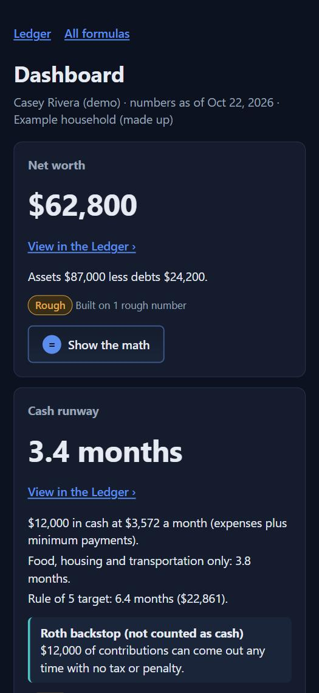
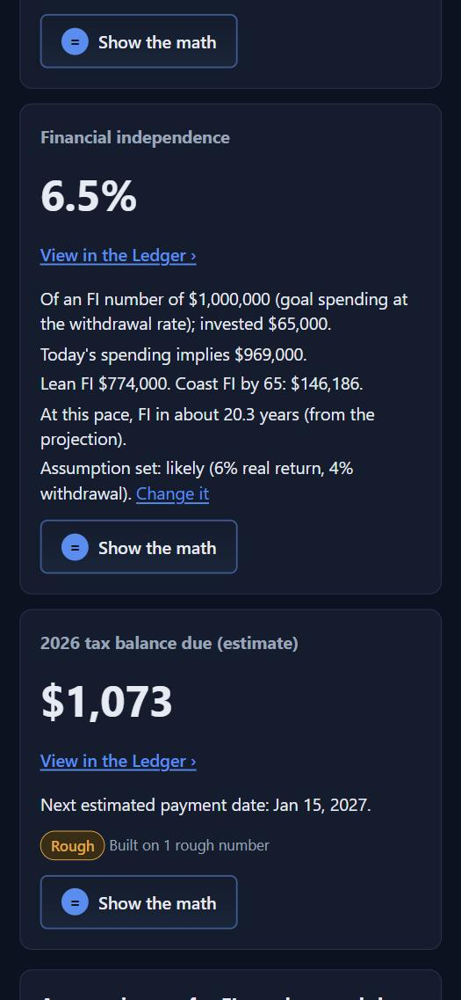
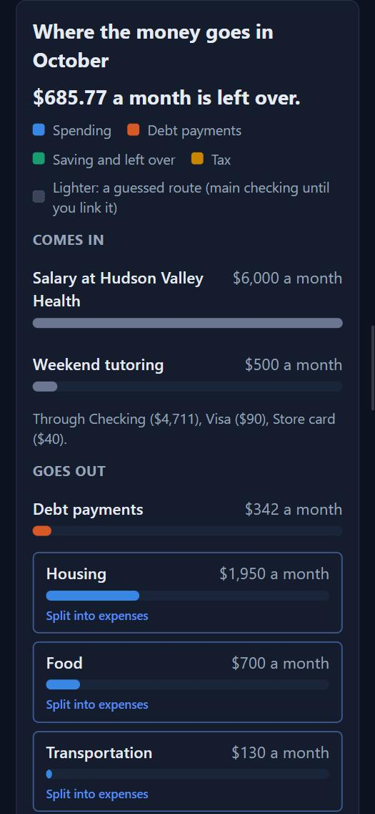
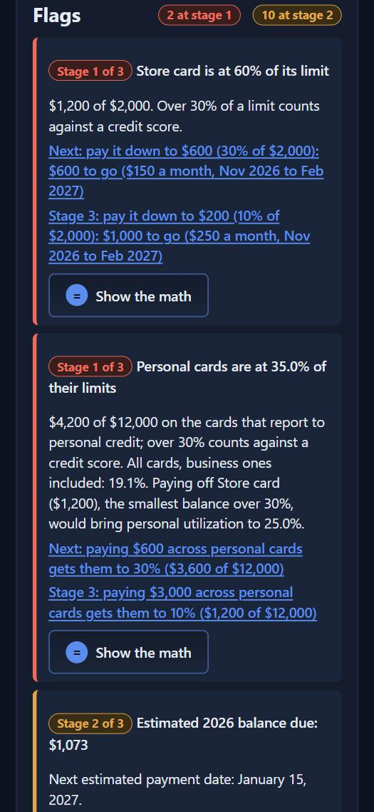
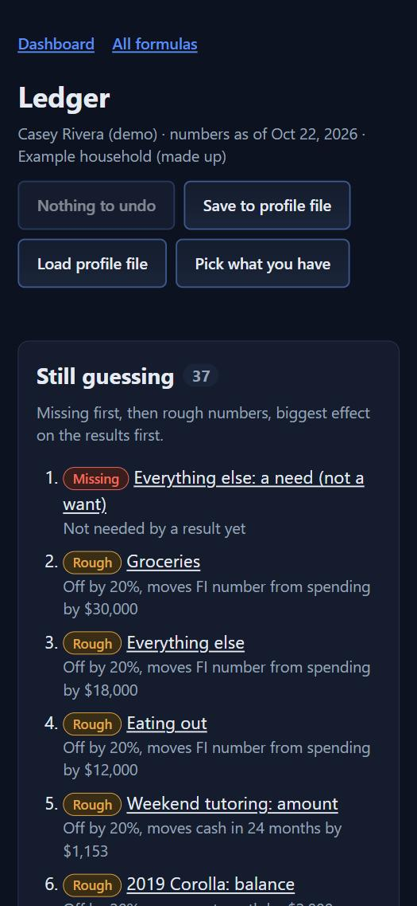
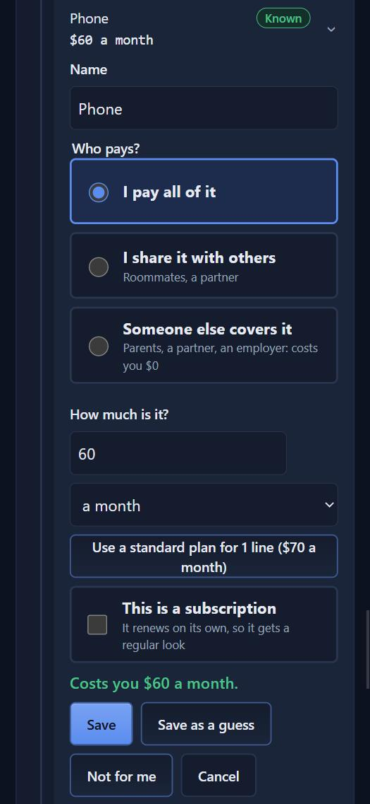
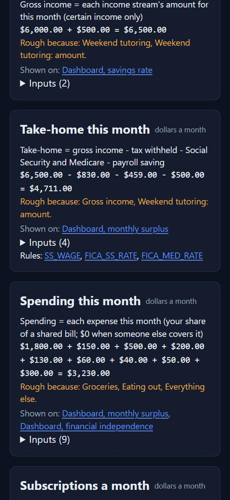
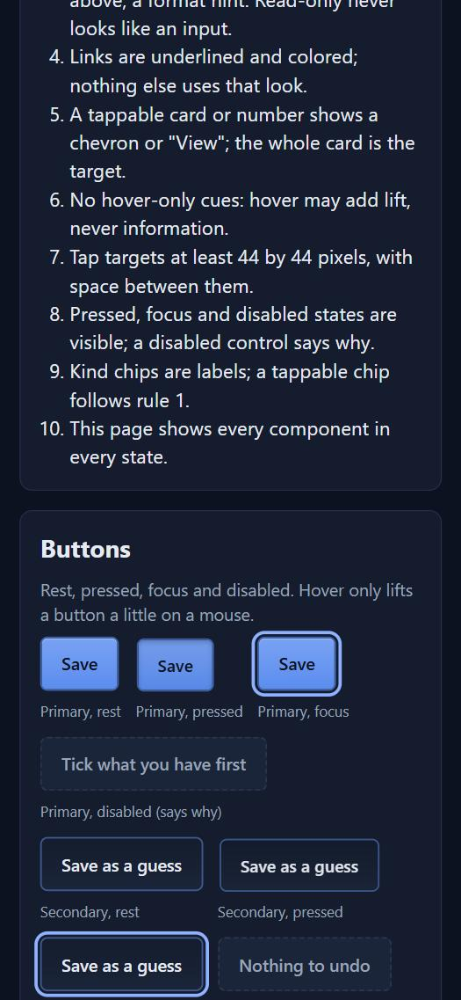

# Phase 1 sign-off checklist

A short list to check by hand before Phase 1 is signed off. This committed copy
uses the made-up demo household (Casey Rivera, `fixtures/demo.json`), so every
value here is safe to publish. Your own numbers, the same checklist, and
screenshots of your screens are in `SIGNOFF.local.md` and `signoff.local/`,
which stay on your machine (gitignored).

**How to look at it on a phone-sized screen:** open the Dashboard, then in the
app's browser pane pick Mobile in the Viewport menu. The local server answers
on this computer only, so a real phone cannot reach it yet (see the questions in
the Phase 1 report).

## 1. Key numbers (demo household, assumption set Likely)

| Where | Expected |
|---|---|
| Net worth | $62,800 |
| Cash runway | 3.4 months; Rule of 5 target 6.4 months ($22,861) |
| Monthly surplus | $686 (exactly $685.77), after a $153.23 tax set-aside |
| 2026 tax balance due | $1,073 (rough) |
| Financial independence | 6.5% of $1,000,000; spending implies $969,000; FI in about 20.3 years |
| Money flow | "$685.77 a month is left over" |
| Flags | 2 at stage 1, 10 at stage 2 |

## 2. Three edits to try (each one, then Undo)

1. Switch the assumption set to Best, then Worst: every FI number and years to
   FI change; Likely is the default when the page opens fresh.
2. In the Ledger, open Phone, choose "Someone else covers it" and pick
   Parents: spending drops by $60 and the phone reads "covered by Parents ($0 to you)".
3. Tap "Missing" in the Show row: only missing fields show, the chip reads
   "Only missing"; tap it again and everything is back.

## 3. Screens at phone width (demo household)

| | |
|---|---|
|  |  |
|  |  |
|  |  |
|  |  |

## 4. What should always hold

- Every big number has "View in the Ledger" and "Show the math", and the math
  recomputes to the number shown (the self-audit test checks all of them).
- Missing never shows as $0; rough numbers say so.
- Buttons look like buttons, links are underlined, nothing overlaps at 375px
  (`DESIGN.md`, `affordances.html`).
