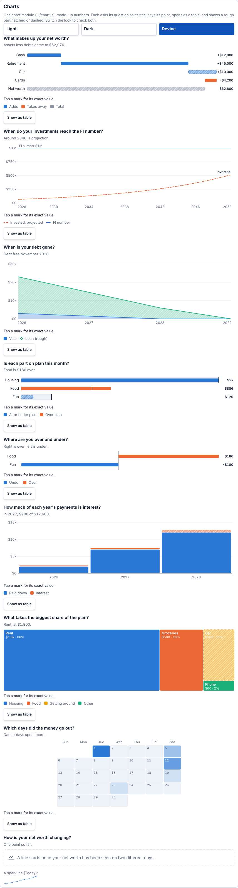
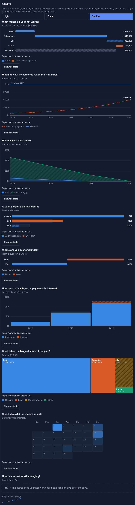
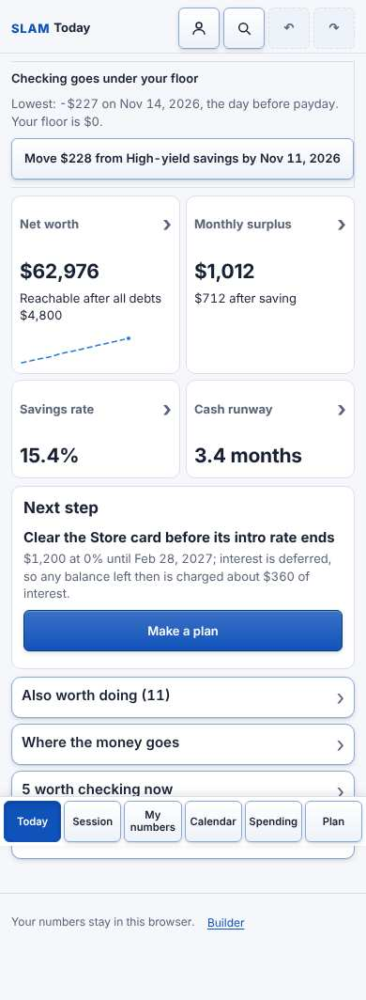
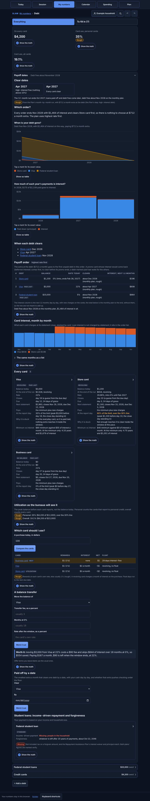
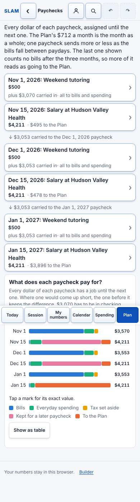
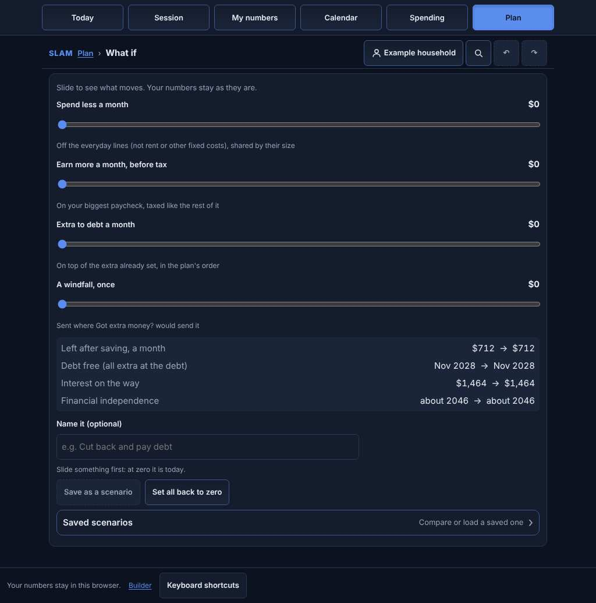

# Good morning: what the overnight run did

**Try it on your phone:** https://claude.ai/artifact/WbU42ruKYa7Z7aZtgrUFU2 (the demo household, made up).
**Branch:** `claude/slam-phase-2` (GitHub Pages serves `main` only, so the work is on the branch until it is merged).

Everything below is on the demo household. Nothing real was read or written.

## In one paragraph

All twelve tracks (A to L) are built, each in its own commit, then four review rounds with a fresh reviewer each time.
The app now has a calendar that is a calendar, a command bar, one chart module behind about 20 charts, a paycheck view
where every dollar has a job, the debt orders side by side, what-if sliders, a subscription audit, a bill negotiation
list, notes, keyboard shortcuts, a Design kit with every chart, and Show the math on the busiest screens that lacked
it. qa-crawl and agree-check pass. Both test suites pass. The reviewers' worst findings fell from 14 high in round 1
to ROUND4_HIGH in round 4; what is left is mostly one engine question: the Debt screen runs two payoff models (a
12-month day-by-day run and a monthly plan) that do not always agree, and that needs a decision and a day session.

## What was built (A to L)

| Track | What you can do now | Where |
|---|---|---|
| A. Calendar | Month grid (default), week, list and year; drag a chip to another day; tap a day for its items; "Add to my calendar" saves a .ics file | Calendar |
| B. Command bar | Ctrl/Cmd+K or the magnifier: find anything, or type "visa 2700", "rent 1950", "add netflix 15.99 on the 12th", "go to plan", "mark rent happened", "undo"; it says what Enter will do first | Every page |
| C. Charts | One chart module: question as title, a sentence, Show as table, tap for exact values, k and M axes, rough hatched or dashed. Net worth waterfall and over time, paycheck and month waterfalls, Budget as charts (bullets, over and under, treemap, day heatmap, months), the cash line with its floor band, debt to zero, interest vs principal, the orders, FI path, savings-rate curve, tax brackets, scenarios, goal progress, a Today sparkline | Each on the screen that asks its question |
| D. Paycheck view | Every dollar of each paycheck has a job; arrows where one paycheck carries a later short one; third-paycheck months marked | Plan, Your money each month, Paychecks |
| E. Debt orders | Highest rate, smallest balance and most stressful side by side with debt-free month, interest and first cleared; a recommendation; "Use this order" (Undo) | My numbers, Debt, Payoff dates |
| F. What if | Sliders: spend less, earn more, extra to debt, a windfall; dates move as you slide; Save as a scenario | Plan, Your future |
| G. Subscription audit | Ranked by cost a year, uses a month gives cost per use, cancel candidates add up | My numbers, Needs, Subscriptions |
| H. Bills worth a call | Phone, internet, TV, insurance, gym and high-rate cards against typical prices, with call scripts and "I called" | Plan, Your money each month |
| I. Notes | A dated note on any number (open its row, or its ⋯ menu); Session notes; shared ones print on the One-pager | My numbers, Session, One-pager |
| J. Keyboard | g then t, s, m, c, b or p; n to add; / or Ctrl+K to find; z to undo; ? for the list | Every page (computer) |
| K. Visual pass | One primary button per screen where there were two; dates in words; the Design kit shows every chart in light and dark | Builder, Design kit |
| L. FEATURES | Show the math added on the money flow, Session totals, Subscriptions, Covered by others, Owed to you, Cash by day; two missing tests | docs/FEATURES.md |

### The charts, light and dark

### A few screens (round 4, phone and computer)

 
 

Every client screen, both sizes, every round: `docs/overnight/round-N/`.

## FEATURES matrix, first and last

| | Done | Partial | Missing | n/a | Rows |
|---|---|---|---|---|---|
| Before (start of the night) | 176 | 195 | 26 | 35 | 72 |
| After | 220 | 206 | 19 | 41 | 81 |

Nine new features were added as rows. Of the 19 missing cells, most are Show the math on older screens (Session's Needs,
Income and Goals steps, Calendar's day screens, Budget's lumpy bills, close the month, the plan learns, fixed and
variable, 50/30/20, Life events, the One-pager, Still guessing) plus What if and Bills worth a call.

## The review rounds, first and last

| Round | High | Medium | Low | qa-crawl | agree-check |
|---|---|---|---|---|---|
| 1 | 14 | 13 | 3 | PASS (3 cents, 6 typed-looking placeholders, 3 raw dates) | PASS |
| 2 | 8 | 18 | 4 | PASS (1 dead click) | PASS |
| 3 | 9 | 17 | 6 | PASS | PASS |
| 4 | ROUND4_HIGH | ROUND4_MED | ROUND4_LOW | ROUND4_QA | ROUND4_AGREE |

What was fixed each round, what went to QUESTIONS and what was left (with reasons): `docs/OVERNIGHT.md`.
Each round's findings: `docs/overnight/round-N/findings.md`.

### Per screen, first round and last

SCREEN_TABLE

## Decisions for you (10)

1. **One debt model or two (QUESTIONS 154, 155, 161, 162).** The Debt screen shows a 12-month day-by-day run (new
   charges, statements, the everyday card paid last, no deferred-interest lump) and a monthly plan (no new charges,
   every extra dollar at the debt). Most remaining review findings come from the two disagreeing. Pick which one the
   Debt screen, the One-pager and What if lead with, and whether the run should charge deferred interest.
2. **Debt free Nov 2028 or Jul 2033 (154).** The Debt screen sends the whole $712 at the debt; the Plan's ladder fills
   reserves and retirement first and gets to the student loan about 2033. Which should the client see first?
3. **The recommended payoff order (153).** Highest rate first unless smallest balance first is a quick win for no more
   than $100 of interest. Keep, or a different rule?
4. **The two emergency targets (156).** The Plan's reserve step and the demo's "Six-month cushion" goal are separate.
   Merge a goal named like a cushion into the reserve step?
5. **Typical bill prices (data/negotiable-2026.json).** Placeholders typed from general knowledge, flagged in the
   file. Confirm or replace with a sourced table before a client sees "above typical".
6. **The demo's subscriptions.** The demo has none marked, so the audit is empty until you tap "Make it a
   subscription" on Streaming or Gym. Marking them in the demo moves six calendar tests; say if it should.
7. **What it takes, with no age typed (160).** It now waits for an age. Or default to 65, or an age in Profile?
8. **Which card for a purchase (157).** It can pick a business card for a personal purchase. Leave business cards out
   unless the purchase is marked business?
9. **Windfall's tax question (158).** Ask only where the money came from and set the tax from that?
10. **Counts that disagree (159, round 1 finding 17).** "13 of 13 filled in" on My numbers and "To fill in (2)" on
    Taxes; Session's question counts against each section's. One list of open questions read everywhere?

## What could not be done

- **The two debt runs** (above): reconciling them is engine work; tonight they are labelled instead.
- **Deferred interest in the day-by-day run** (161): engine work.
- **The Debt screen's length and its older interest chart**: it should fold its tools and move that chart onto the
  shared module; a day session.
- **The FI numbers on Goals** (seven of them): all are in the spec; a calmer layout is a day-session change.
- **399 small tap targets** that qa-crawl reports (calendar chips, inline links): reported, not blocking; worth a
  pass of their own.
- **agree-check covers 21 metrics.** The disagreements the reviewers found were in numbers it does not track
  (debt-free month, interest totals, to the Plan a month). Registering them is the next step for that tool.
- **One more round**: the loop stopped after round 4 because rounds 3 and 4 changed little (STOP_REASON).

## Checks at the end

FINAL_CHECKS
